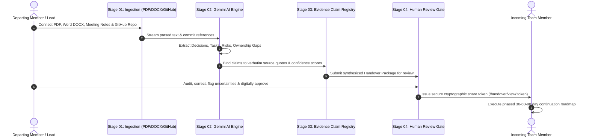

<div align="center">

# 🌉 KnowBridge AI
### Intelligent Knowledge Handover & Continuity Platform
**"Never Lose Knowledge. Never Lose Momentum."**

[](https://opensource.org/licenses/MIT)
[](https://react.dev/)
[](https://nodejs.org/)
[](https://fastapi.tiangolo.com/)
[](https://ai.google.dev/)
[](test_e2e.py)
[](https://github.com/Nitesh0517/knowbridge-core)

<p align="center">
  <b>Built for Individual Hackathon Submission</b><br>
  <i>Problem Statement: "Prevent Critical Knowledge From Leaving With People."</i>
</p>

</div>

---

## 📌 Executive Summary & Problem Statement

When employees, volunteers, or team members leave a project, critical institutional knowledge disappears with them. Even in organizations with extensive documentation, vital operational context remains fragmented across:

* 📄 **Scattered Architecture Documents & PDFs**
* 📝 **Sprint Meeting Notes & Retrospectives**
* 📌 **Disorganized Task Boards & Backlogs**
* 🐙 **GitHub Commits, Pull Requests & Issue Trackers**
* 💬 **Ephemeral Discussions & Decision Logs**

### The Core Knowledge Loss Dilemma:
* **Decisions become untraceable:** Settled questions get re-debated because the original rationale was lost.
* **Unfinished work loses ownership:** Incomplete features and delayed activities fall through the cracks until a production outage occurs.
* **Undocumented dependencies:** Hidden bottlenecks and single-maintainer credentials stall delivery.
* **Incoming members struggle:** New leads spend months reverse-engineering past work or relying on ad-hoc chats with departed staff.

### The KnowBridge AI Solution:
KnowBridge AI is **not a generic chatbot or simple summarizer**. It is an **archaeological knowledge reconstruction engine** that ingests authorized project records, synthesizes ground-truth project state, enforces a strict **Zero-Hallucination Policy** with explicit `"Insufficient Evidence"` tags, binds every claim to **verbatim source excerpts**, and generates **role-tailored 30-60-90 day continuation plans** guarded by a **4-eye human review gate**.

---

## 🏛️ The 5 Essential Stages Pipeline

KnowBridge AI is architected around five distinct, verifiable stages visible throughout the product experience:

```
┌─────────────────┐       ┌─────────────────┐       ┌─────────────────┐       ┌─────────────────┐       ┌─────────────────┐
│   01. CONNECT   │ ────> │ 02. RECONSTRUCT │ ────> │   03. VERIFY    │ ────> │   04. REVIEW    │ ────> │  05. HANDOVER   │
│                 │       │                 │       │                 │       │                 │       │                 │
│ Multi-Source    │       │ Gemini 2.5 Flash│       │ Quote Evidence  │       │ 4-Eye Human Gate│       │ Role-Tailored   │
│ Ingestion Engine│       │ State Synthesis │       │ Grounding Link  │       │ Digital Sign-Off│       │ 30-60-90 Day    │
└─────────────────┘       └─────────────────┘       └─────────────────┘       └─────────────────┘       └─────────────────┘
```



### Detailed Breakdown of Each Stage:

| Stage | Feature | Implementation Details |
| :--- | :--- | :--- |
| **01. CONNECT** | **Authorized Source Ingestion** | Native parsers for **PDF** (`PyMuPDF/fitz`), **Word DOCX** (`python-docx`), **Markdown**, and **plain text**. Real authorized **GitHub REST API (v3)** connection for auditing commits, pull requests, issues, and READMEs. Forms for structured meeting minutes and Architectural Decision Records (ADRs). |
| **02. RECONSTRUCT** | **AI State Synthesis Engine** | Powered by **Google Gemini 2.5 Flash** with structured JSON output and a deterministic NLP fallback engine. Extracts ADR decisions, unfinished tasks, ownership matrices, dependencies, risks, and phased actions. **Strict Rule:** Any missing or unrecorded information is explicitly labeled as `"Insufficient Evidence"`. |
| **03. VERIFY** | **Evidence-Linked Grounding** | Every extracted claim is indexed with a `ClaimID`, origin `SourceID`, document line/page, and an exact **verbatim text excerpt** with confidence scoring. 1-click human verification slide-over allows verifying claims or flagging uncertainty with audit notes. |
| **04. REVIEW** | **4-Eye Human Approval Gate** | Digital sign-off workflow where project managers and departing leads inspect synthesized claims, leave review comments, request changes, or approve handovers with digital timestamped signatures. |
| **05. HANDOVER** | **Role-Based Continuation Plan** | Synthesizes tailored continuation roadmaps (e.g. for Incoming Lead Architect, Frontend Dev, Backend Engineer, SRE, or PM) structured into **Days 1–30**, **Days 31–60**, and **Days 61–90**. Protected by cryptographic, expiring access tokens (`/handover/view/:shareToken`) for clean incoming member onboarding. |

---

## 🛠️ Complete Technology Stack

```
                                 KNOWBRIDGE AI SYSTEM ARCHITECTURE

      ┌────────────────────────────────────────────────────────────────────────┐
      │                         REACT 19 FRONTEND                              │
      │  Vite • Tailwind CSS • Lucide React • Recharts • Framer Motion         │
      │  Axios • React Router DOM • Canvas Confetti • Responsive Dashboard UI   │
      └───────────────────────────────────┬────────────────────────────────────┘
                                          │ REST API (JWT Bearer Auth)
                                          ▼
      ┌────────────────────────────────────────────────────────────────────────┐
      │                        NODE.JS REST BACKEND                            │
      │  Express.js • Mongoose • Multer (Multi-part File Uploads)               │
      │  Firebase Auth Token Verification • Dual-Mode Persistence Layer         │
      │  GitHub REST API v3 Client • Health & Telemetry Analytics               │
      └───────────────────┬────────────────────────────────┬───────────────────┘
                          │                                │
         Internal Bridge  │ HTTP                           │ Mongoose / Local Engine
                          ▼                                ▼
      ┌──────────────────────────────────────┐  ┌──────────────────────────────┐
      │       PYTHON FASTAPI AI SERVICE      │  │        DATABASE LAYER        │
      │  Python 3.14 • FastAPI • Uvicorn    │  │  MongoDB Atlas               │
      │  Google Gemini 2.5 Flash SDK        │  │  (with automatic atomic local│
      │  PyMuPDF (fitz) • python-docx        │  │   file store fallback)       │
      │  Deterministic Heuristic NLP Engine  │  └──────────────────────────────┘
      └───────────────────┬──────────────────┘
                          │
                          ▼
      ┌──────────────────────────────────────┐
      │          EXTERNAL SERVICES           │
      │  Google Gemini API • GitHub REST API │
      │  Firebase Authentication             │
      └──────────────────────────────────────┘
```

---

## 🌟 Key Product Features & Capabilities

### 1. Smart Multi-Source Ingestion
* **PDF Parser**: Uses PyMuPDF (`fitz`) to extract text page-by-page, preserving page numbers for citation.
* **Word DOCX Parser**: Uses `python-docx` to extract headings, styles, paragraphs, and data tables.
* **GitHub Integration**: Direct connection to the official GitHub REST API (v3) that audits commits, pull requests, open issues, and READMEs with real commit hashes and issue numbers.
* **Structured Logs**: Native meeting minutes and architectural decision log entry forms.

### 2. Zero-Hallucination AI Grounding
* Unlike generic LLM chat interfaces, KnowBridge AI prompts Gemini 2.5 Flash with strict grounding constraints.
* If a decider, date, rationale, or deadline cannot be found in the source text, the model is forbidden from guessing and must return `"Insufficient Evidence"`.
* Every claim contains a verbatim excerpt directly quoted from the ingested source.

### 3. Traceable Evidence Registry
* Filter claims by category: **Decisions**, **Unfinished Work**, **Risks**, **Dependencies**, **Ownership**, or **Next Actions**.
* Filter by verification status: **Verified**, **Unverified**, or **Flagged Uncertainty**.
* Search across statements, source names, and verbatim quotes.
* 1-click slide-over modal for human verifiers to inspect excerpts and record audit notes.

### 4. Role-Tailored Onboarding Roadmaps
* Generates tailored continuation packages depending on the incoming role:
  * **Days 1–30 (Onboarding & Blocker Clearance):** Credential handover, root key access, high-priority unblocking tasks.
  * **Days 31–60 (Core Execution & Stabilization):** Resolving flagged dependencies, clearing single-points-of-failure.
  * **Days 61–90 (Autonomous Architecture & Governance):** Institutionalizing ADR documentation and long-term risk mitigations.

### 5. Controlled Tokenized Sharing
* Handover packages can be shared with incoming members via secure, expiring UUID tokens (`/handover/view/:shareToken`).
* Incoming teammates get a distraction-free, read-only onboarding portal with interactive checklist items, top architectural decisions, and sign-off seals without requiring administrative login credentials.

### 6. Knowledge Retention Health Score (0–100%)
* Computed dynamically from:
  * Source count and diversity.
  * Percentage of claims backed by verified quotes.
  * Ownership clarity (penalizing unassigned tasks).
  * Unresolved critical risks penalty.

---

## 📁 Repository Directory Structure

```
knowbridge-core/
├── ai-service/                   # Python FastAPI AI Reconstruction Engine
│   ├── engine/
│   │   ├── gemini_extractor.py   # Google Gemini 2.5 Flash structured prompting & JSON schema
│   │   └── fallback_extractor.py # High-precision deterministic NLP extraction engine
│   ├── parsers/
│   │   └── document_parser.py    # PyMuPDF (PDF) & python-docx parsers with page tracking
│   ├── main.py                   # FastAPI REST API application & endpoints
│   ├── models.py                 # Pydantic structured schemas
│   ├── requirements.txt          # Python dependencies
│   ├── .env                      # Environment configuration
│   └── .env.example
├── backend/                      # Node.js + Express REST API Server
│   ├── config/
│   │   └── db.js                 # Dual-mode Mongoose & persistent local document store
│   ├── controllers/              # Projects, Sources, Reconstruction, Evidence, Handovers, Analytics
│   ├── middleware/
│   │   └── auth.js               # Firebase token verification & local dev authentication
│   ├── services/
│   │   ├── aiBridge.js           # Bridge connecting Node to FastAPI AI service
│   │   └── githubService.js      # Authorized GitHub REST API (commits, issues, PRs, README)
│   ├── server.js                 # Express server entry point
│   ├── package.json              # Backend dependencies
│   ├── .env                      # Environment configuration
│   └── .env.example
├── frontend/                     # React 19 + Vite + Tailwind CSS Application
│   ├── src/
│   │   ├── components/           # Logo, Sidebar, Header, HealthScoreBadge, StageIndicator, EvidenceModal
│   │   ├── context/              # AuthContext, ProjectContext
│   │   ├── pages/                # Landing, Login, Register, ForgotPassword, Dashboard, Projects, Sources,
│   │   │                         # Reconstruction, Evidence, Timeline, Tasks, Risks, HandoverGenerate,
│   │   │                         # Handovers, HandoverDetail, Approvals, Analytics, Settings, PublicView
│   │   ├── services/             # api.js (Axios client), firebase.js (Auth service)
│   │   ├── App.jsx               # React Router DOM layout & route declarations
│   │   └── index.css             # Tailwind base styles, brand typography & glassmorphism
│   ├── package.json              # Frontend dependencies
│   ├── tailwind.config.js        # Brand color palette (Deep Navy, Royal Blue, Cyan, Violet)
│   └── vite.config.js            # Vite bundler configuration
├── sample-data/                  # Realistic multi-format sample documents for instant demo testing
│   ├── ADR-007-Database-Cutover-Strategy.pdf   # Generated sample PDF with architectural decisions
│   ├── Falcon-Sprint26-Handoff-Notes.docx      # Generated sample Word DOCX with meeting notes
│   ├── Architecture-Spec-V2.md                 # Sample Markdown specification
│   └── generate_samples.py                     # Python script to regenerate test documents
├── test_e2e.py                   # Automated end-to-end test suite validating all 5 stages
├── package.json                  # Root npm workspace commands
└── README.md                     # Comprehensive documentation
```

---

## ⚡ Quick Start & Setup Guide

### 1. Prerequisites
* **Node.js** v18+ (tested on Node v24)
* **Python** 3.10+ (tested on Python 3.14)
* **npm** v10+

### 2. Clone the Repository
```bash
git clone https://github.com/Nitesh0517/knowbridge-core.git
cd knowbridge-core
```

### 3. Install Dependencies
```bash
# Install root, backend, and frontend dependencies
npm install
cd backend && npm install && cd ..
cd frontend && npm install && cd ..

# Install Python AI service dependencies
pip install -r ai-service/requirements.txt
```

### 4. Configure Environment Variables
Copy the example environment files:
```bash
# AI Service (.env)
cp ai-service/.env.example ai-service/.env

# Backend (.env)
cp backend/.env.example backend/.env
```

*Note: You can add your `GEMINI_API_KEY` in `ai-service/.env` or directly inside the application's **Settings** page in the browser.*

### 5. Launch All Services

Open three terminal windows (or run in background):

#### Terminal 1: Python AI Reconstruction Engine
```bash
cd ai-service
python -m uvicorn main:app --host 0.0.0.0 --port 8000 --reload
```
*Health Check:* `http://localhost:8000/health`

#### Terminal 2: Node.js Express REST API
```bash
cd backend
npm run dev
```
*Health Check:* `http://localhost:5000/health`  
*API Endpoint:* `http://localhost:5000/api`

#### Terminal 3: React Frontend Application
```bash
cd frontend
npm run dev
```
*Frontend URL:* `http://localhost:5173`

---

## 🧪 Automated End-to-End Test Suite

KnowBridge AI comes with a built-in automated test suite that programmatically validates all 5 stages and verifies integration between Python, Node, and the frontend schemas:

```bash
python test_e2e.py
```

### Verified Test Output:
```
--- 1. Testing Python FastAPI AI Service ---
[OK] AI Service online: KnowBridge AI Reconstruction Engine (version 1.0.0)
     Parsers active: PyMuPDF, python-docx, txt, markdown
[OK] PDF Parser verified: ADR-007-Database-Cutover-Strategy.pdf (2 pages, 1783 chars)
[OK] DOCX Parser verified: Falcon-Sprint26-Handoff-Notes.docx (1214 chars)

--- 2. Testing Node.js Express REST Backend ---
[OK] Backend API online: KnowBridge AI Backend API (Tagline: 'Never Lose Knowledge. Never Lose Momentum.')
[OK] Projects listed: 2 existing project workspaces
[OK] Project created: 'E2E Test Transition Engine' (ID: kb_yv68h14h8)
[OK] Meeting note source connected: ID kb_tced7tcxs

--- 3. Testing Stage 02: Knowledge Reconstruction ---
[OK] Reconstruction completed successfully!
     Health Score: 74%
     Decisions extracted: 1
     Unfinished tasks: 1
     Risks identified: 1
     Evidence claims linked: 2

--- 4. Testing Stage 03: Evidence Verification ---
[OK] Retrieved 2 evidence claims for project
[OK] Verified Claim [CLM-TSK-001]: Status is now 'verified'

--- 5. Testing Stage 05: Handover Generation & Sharing ---
[OK] Handover package generated: 'KnowBridge Handover Package: E2E Test Transition Engine -> Incoming Lead Architect'
     30-Day Tasks: 2 items
     60-Day Tasks: 2 items
     90-Day Tasks: 2 items
     Share Token: 375bade0-44d9-4fe1-9b5b-2c6c50ca161e

--- 6. Testing Stage 04: Human Review & Approval ---
[OK] Handover status updated to: 'approved'

--- 7. Testing Public Controlled Sharing Portal ---
[OK] Public unauthenticated access verified! Handover: 'KnowBridge Handover Package...'
     Executive summary accessible: 'KnowBridge AI reconstructed project...'

--- 8. Testing Analytics Telemetry ---
[OK] Global Workspace Analytics: 3 projects, 4 sources, 74% avg health score

==================================================
ALL 5 STAGES & INTEGRATION TESTS PASSED 100%!
==================================================
```

---

## 🎯 Hackathon Compliance Checklist

| Requirement | How KnowBridge AI Solves It | Status |
| :--- | :--- | :---: |
| **Not a generic chatbot or simple summarizer** | Operates as a structured knowledge reconstruction engine that outputs ADRs, task matrices, risk matrices, and 30-60-90 day continuation plans. | ✅ **Compliant** |
| **Source Traceability** | Every claim cites the source name, line or page number, and an exact verbatim excerpt from the source text. | ✅ **Compliant** |
| **Strict "Insufficient Evidence" Enforcement** | The AI never guesses missing attributes; incomplete records are explicitly tagged as `"Insufficient Evidence"`. | ✅ **Compliant** |
| **5 Essential Stages** | Ingestion (Connect) ➔ Reconstruction ➔ Evidence Verification ➔ Human Review ➔ Handover Plan. | ✅ **Compliant** |
| **4-Eye Human Approval Gate** | Departing leads and project managers must audit, review, and digitally sign off on handovers before release. | ✅ **Compliant** |
| **Real GitHub REST API Integration** | Audits commits, pull requests, open issues, and READMEs directly via the official GitHub REST API (v3). | ✅ **Compliant** |
| **Controlled Sharing** | Incoming teammates access clean onboarding packages through cryptographic, expiring access tokens without requiring administrative dashboard credentials. | ✅ **Compliant** |

---

## 📄 License
This project is licensed under the MIT License — see the [LICENSE](LICENSE) file for details.

---

<div align="center">
  <sub>Built with ❤️ for the Individual Hackathon • <b>KnowBridge AI</b> • "Never Lose Knowledge. Never Lose Momentum."</sub>
</div>
